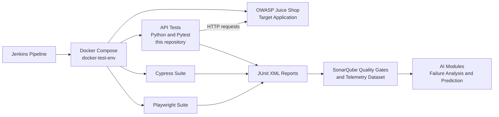

# 🧪 Automated REST API Testing Framework: Python, Pytest & OWASP Juice Shop


### Component & Contract Validation for REST APIs, Built with Python and Pytest

This repository hosts an automated **API testing suite** that validates the RESTful services of the **[OWASP Juice Shop](https://github.com/juice-shop/juice-shop)** application. It covers **authentication, product catalog and user registration** workflows in isolation, and produces **JUnit XML reports** that feed the CI/CD pipeline and quality telemetry.

It is the **API testing layer** of a larger ecosystem: [docker-test-env](https://github.com/acorvello/docker-test-env) runs it in a container through a **Jenkins pipeline**, together with the Cypress and Playwright suites, with **SonarQube** quality gates and unified telemetry for AI modules.

---

## 🗺️ Quick Navigation

* [Engineering Highlights](#-engineering-highlights)
* [Where It Fits: CI/CD Pipeline](#-where-it-fits-cicd-pipeline)
* [Tech Stack](#%EF%B8%8F-tech-stack--dependencies)
* [Project Structure](#-project-structure)
* [Covered Scenarios](#-covered-scenarios)
* [Running Locally](#-running-locally)
* [Running via Docker](#-running-via-docker-cicd-orchestration)
* [Roadmap](#-roadmap--next-steps)

---

## 💡 Engineering Highlights

* **Fixture-Based Design:** `pytest` dependency injection with optimized fixture scopes, avoiding redundant state setup across tests.
* **Contract Validation:** Verification of HTTP status codes and error response integrity, including checks that responses **do not leak internal stack traces**.
* **CI/CD Integration:** Runs headless inside a Docker container orchestrated by a Jenkins pipeline, merging results into unified **JUnit reports**.

---

## 🧭 Where It Fits: CI/CD Pipeline



---

## 🛠️ Tech Stack & Dependencies

* **Core Language:** Python 3.10+
* **Test Runner:** `pytest` (headless automation, filtering, and structural hooks)
* **HTTP Client:** `requests` (session management and connection pooling)
* **Target Application:** OWASP Juice Shop
* **CI/CD:** Docker, Jenkins (via [docker-test-env](https://github.com/acorvello/docker-test-env))

---

## 📁 Project Structure

```text
api-testing/
├── requirements.txt
├── pytest.ini
└── tests/
    ├── conftest.py
    ├── test_products_api.py
    ├── test_login_api.py
    └── test_registration_api.py
```

---

## 🔍 Covered Scenarios

### Products
* Listing products returns valid response payloads
* Searching products by term filters results
* Fetching a single product by ID
* Boundary validation: fetching a non-existent product returns a clean `404`

### Login
* Security validation: invalid credentials are rejected with a strict `401`
* Missing request body is handled without unhandled exceptions
* Error handling: responses do not leak internal stack traces

### User Registration
* Lifecycle validation: a newly registered user can log in immediately after
* Validation failure when the password confirmation doesn't match
* Data integrity: registration fails for a duplicate email

---

## 🚀 Running Locally

**Prerequisites:** Python 3.10+ and a running instance of Juice Shop (locally or in a container).

**Windows (PowerShell):**

```powershell
python -m venv .venv
.\.venv\Scripts\Activate.ps1
pip install -r requirements.txt
$env:BASE_URL = "http://localhost:3001"
pytest
```

**Linux / macOS:**

```bash
python -m venv .venv
source .venv/bin/activate
pip install -r requirements.txt
BASE_URL=http://localhost:3001 pytest
```

To generate a JUnit XML report, as the CI pipeline does:

```bash
pytest --junitxml=reports/junit.xml
```

---

## 🐳 Running via Docker (CI/CD Orchestration)

This repository is consumed by the [docker-test-env](https://github.com/acorvello/docker-test-env) orchestration project. It spins up Juice Shop and runs this suite inside a lightweight Python container image, triggered by a **Jenkins pipeline** alongside the Cypress and Playwright suites. See that project's `docker-compose.yml` for the full architecture.

---

## 🔗 Related Projects

* [docker-test-env](https://github.com/acorvello/docker-test-env): Docker Compose + Jenkins + SonarQube orchestration
* [e2e-cypress-js](https://github.com/acorvello/e2e-cypress-js): Cypress E2E suite
* [e2e-playwright-python](https://github.com/acorvello/e2e-playwright-python): Playwright E2E suite
* [Profile & ecosystem overview](https://github.com/acorvello)

---

## 📈 Roadmap & Next Steps

* Implement strict JSON Schema validation for response payloads
* Expand coverage to basket, cart, and checkout endpoints
* Inject authenticated requests using automated token reuse from the login endpoint

---

## ⚖️ License

This repository is licensed under the **MIT License**. Feel free to clone, study, modify, and distribute the code for educational or portfolio purposes.

---

## 👤 Author

**Alexsander Corvello da Silveira**, Senior QA Engineer focused on AI-driven testing and applied machine learning.
GitHub: [@acorvello](https://github.com/acorvello)
